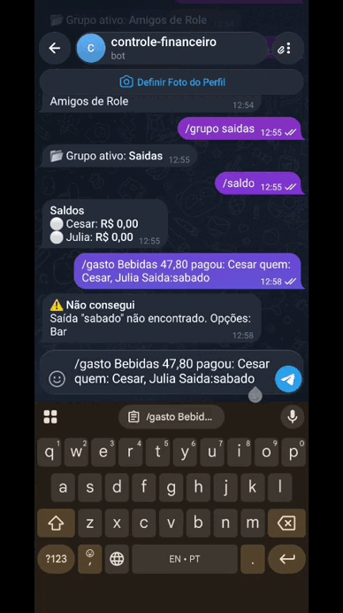

# rachaconta

[](https://github.com/LittleCesta/controle-financeiro/actions/workflows/ci.yml)

Divisão de gastos entre amigos, com site e bot do Telegram. Registra quem pagou o quê, divide entre quem participou, calcula quanto cada pessoa deve e acompanha os pagamentos até zerar as contas.

Nasceu de um problema real: depois de cada rolê, uma pessoa paga o Uber, outra paga o bar, e a conta de quem deve a quem vira bagunça no grupo de mensagens. Aqui, o gasto é lançado em uma mensagem no Telegram e o site mostra os saldos na hora.

## Demonstração



## Funcionalidades

**Contas e grupos**

- Cadastro e login. Cada grupo só é visível para os seus membros.
- **Convite por link:** quem entra escolhe qual pessoa do grupo é (ou cria o próprio nome), e a conta fica ligada a ela.

**Site**

- Grupos com pessoas e **saídas** (um rolê agrupa vários gastos), com filtro por saída, ordenação por data e paginação.
- Gastos com divisão igual ou **valores diferentes por pessoa** (quem chegou tarde, quem não bebeu).
- Saldo de cada pessoa e **transferências mínimas** para zerar as contas, com registro do pagamento em um clique (inclusive parcial).
- Edição de gastos e remoção de gastos e pagamentos, com confirmação em modal.
- **Relatório em PDF** com saldos, gastos detalhados e pagamentos.

**Bot do Telegram**

- **Assistente com botões** para lançar gastos, ou lançamento direto em uma mensagem, com data opcional (sem data, vale o dia do envio).
- Consulta de saldos e envio do relatório em PDF.
- Responde só ao dono, em conversa privada, e só enxerga os grupos da conta dele.

## Como o bot recebe um gasto

**Com botões.** Envie só a descrição e o valor:

```
/gasto Uber 60
```

O bot responde com um cartão que se edita a cada toque. Todos começam marcados: você desmarca quem não participou e escolhe quem pagou, a saída e a data (hoje, ontem, 2 ou 3 dias atrás, ou uma data digitada). Por fim, **Confirmar**. Quem paga por padrão é a pessoa ligada à sua conta. O toque duplo em Confirmar grava uma vez só.

**Direto, em uma mensagem.** Se a mensagem trouxer qualquer campo, o bot grava sem botões:

```
/gasto Uber 60 pagou:Cesar quem:Cesar,Ana,Bia saida:"Sábado Varanda" data:02/11
/gasto Bar 200 pagou:Ana quem:Cesar,Ana,Bia,Davi:20
```

| Campo    | O que faz                                                                     | Padrão                 |
| -------- | ----------------------------------------------------------------------------- | ---------------------- |
| `pagou:` | Quem pagou                                                                    | Nome definido em `/eu` |
| `quem:`  | Participantes. `Davi:20` fixa 20 para o Davi e divide o resto entre os outros | Todo o grupo           |
| `saida:` | Saída do gasto (precisa existir no site). Use aspas se tiver espaço           | Nenhuma                |
| `data:`  | `02/11`, `02/11/2026`, `hoje` ou `ontem`                                      | Dia do envio           |

Valores diferentes por pessoa só existem no formato direto e no site. Outros comandos: `/grupo Nome`, `/eu Nome`, `/saldo`, `/relatorio`, `/ajuda`. Nomes são comparados sem diferenciar acento ou maiúscula; se o nome for ambíguo, o bot responde com as opções em vez de gravar.

## Decisões técnicas

- **Dinheiro em centavos inteiros.** Em ponto flutuante, `0.1 + 0.2 !== 0.3`; com centavos, a soma das partes de um gasto sempre fecha o total. Na divisão por 3, quem sobra paga 1 centavo a mais.
- **O saldo é calculado, não salvo.** O banco guarda os fatos (gastos, partes de cada um, pagamentos) e o saldo sai de `pagou - parte + pagamentos feitos - pagamentos recebidos`. Corrigir um gasto atualiza tudo sem risco de inconsistência, e a soma dos saldos é sempre zero.
- **Quitação com menos transferências.** Cobrar gasto a gasto gera pagamentos cruzados; o saldo líquido reduz isso. Numa noite com um Uber de R$ 60 e um bar de R$ 200, são 3 transferências em vez de 5.
- **Pessoa e conta são coisas diferentes.** Pessoa é quem participa das contas; conta é quem faz login. Os amigos existem como pessoas antes de ter conta, e o convite liga as duas, sem nunca deixar duas contas na mesma pessoa.
- **Uma guarda de acesso só.** Todas as rotas de `/g/:id` ficam sob o mesmo roteador, que exige login e participação no grupo. Rota nova nasce protegida, e quem não é membro recebe "não encontrado", como se o grupo não existisse.
- **Senhas e sessões.** Senha com `scrypt` e sal aleatório; sessão guardada no MongoDB, em cookie `httpOnly` e `sameSite=lax`, com o id renovado a cada login. O destino depois do login só aceita caminhos internos do site (os testes pegaram uma brecha de redirecionamento com barra invertida, já corrigida).
- **Remoção lógica (_soft delete_).** Gastos e pagamentos removidos ganham `deletedAt` e saem das contas, mas continuam no banco.
- **Um serviço único para criar gasto.** O site e o bot usam as mesmas funções (`createExpense`, `updateExpense`, `loadReportData`), então a validação e o relatório nunca divergem entre os dois.
- **Falha cedo.** Faltando uma variável de ambiente obrigatória, o processo não sobe: avisa qual é e sai. O `/health` só responde "ok" se o banco também responde.

## Estrutura

```
src/
  config/
    db.ts                 conexão e collections do MongoDB
    environment.ts        variáveis de ambiente em um lugar só, com validação
  domain/                 regras de dinheiro, sem banco nem Express
    finance.ts            conversão, divisão, saldos e quitação
    pagination.ts         paginação da lista de gastos
  services/               usado pelo site e pelo bot
    expenses.ts           criar e editar gasto
    report.ts             dados e PDF do relatório
  web/
    server.ts             conecta ao banco e sobe o servidor
    app.ts                monta o Express (sessão, rotas, erros)
    auth.ts               senha, sessão e guardas de acesso
    routes/               account, home, invites e group/ (tudo em /g/:id)
  bot/
    bot.ts                comandos do bot (processo separado do site)
    gastoWizard.ts        assistente de /gasto com botões
    draft.ts              regras do rascunho do assistente
  scripts/claim-groups.ts atribui grupos antigos a uma conta
views/                    templates EJS
public/css/               estilos
Dockerfile                imagem de produção (build em duas etapas, usuário não-root)
docker-compose.yml        site, bot e túnel Cloudflare
```

Collections: `users`, `groups`, `people`, `outings`, `expenses`, `payments`, `bot_state` e `sessions`.

## Como executar (desenvolvimento)

Pré-requisitos: Node.js 22+, npm e um MongoDB: o [Atlas](https://www.mongodb.com/atlas) ou um local (`docker run -d -p 27017:27017 mongo:7`).

```bash
git clone https://github.com/LittleCesta/controle-financeiro.git
cd controle-financeiro
npm install
cp .env.example .env.development     # e preencha os valores
```

O `.env.development` (e o `.env.production`) ficam fora do git. Veja os nomes das variáveis em `.env.example`:

```
NODE_ENV=development
PORT=3000
MONGO_URL=mongodb://localhost:27017
SESSION_SECRET=um_valor_longo_e_aleatorio   # obrigatório em produção

# Bot (opcional)
TELEGRAM_TOKEN=token_gerado_no_BotFather
TELEGRAM_OWNER_ID=seu_id_numerico_do_telegram
BOT_USER_EMAIL=email_da_sua_conta_no_site
```

Para gerar o `SESSION_SECRET`: `node -e "console.log(require('crypto').randomBytes(32).toString('hex'))"`.

Depois:

```bash
npm run dev     # site em http://localhost:3000
npm run bot     # bot do Telegram (em outro terminal)
```

No primeiro acesso, abra `/cadastro` e crie a sua conta. Ao criar um grupo você vira o dono e já entra como uma das pessoas; para convidar amigos, copie o link na seção **Membros**. Se você já tinha grupos de antes do login existir, atribua-os à sua conta com `npm run claim -- seu@email.com`.

Para o bot: crie o bot com o `@BotFather` (comando `/newbot`) para obter o token, e descubra o seu ID numérico com o `@userinfobot`.

| Script                        | O que faz                                           |
| ----------------------------- | --------------------------------------------------- |
| `npm run dev`                 | Site com recarga automática (`.env.development`)    |
| `npm run bot`                 | Bot do Telegram (`.env.development`)                |
| `npm run bot:prod`            | Bot com o `.env.production`                         |
| `npm run claim -- email`      | Atribui grupos antigos à conta (`.env.development`) |
| `npm run claim:prod -- email` | O mesmo, no banco de produção                       |
| `npm test`                    | Testes                                              |
| `npm run format`              | Formata o código com o Prettier                     |
| `npm run build` / `npm start` | Compila para `dist/` / roda o site compilado        |

O `db.ts` define DNS públicos (1.1.1.1 e 8.8.8.8) para o Node, porque em algumas redes a consulta SRV do `mongodb+srv://` (Atlas) é recusada pelo DNS padrão.

## Produção com Docker

Com o `.env.production` preenchido (`NODE_ENV=production`, `PORT=3033`, `MONGO_URL`, `SESSION_SECRET` e as variáveis do bot):

```bash
docker compose up -d --build
docker compose ps                 # o web deve aparecer como "healthy"
docker compose logs tunnel        # mostra a URL pública do túnel
```

O compose sobe três serviços: `web` (o site, com healthcheck em `/health`), `bot` (o bot do Telegram) e `tunnel` (um túnel Cloudflare que publica o site sem abrir porta no roteador). A URL do túnel rápido muda a cada reinício; para um endereço fixo, é preciso um túnel nomeado da Cloudflare.

O Telegram só admite um processo lendo as mensagens de cada token. Se o bot rodar no Docker e também na sua máquina com o mesmo token, os dois brigam e dão erro de conflito. Use um bot (token) para desenvolvimento e outro para produção.

## Testes e CI

`npm test` cobre quatro áreas:

- **Regras de dinheiro:** conversão de valores, divisão (incluindo valor fixo por pessoa), saldos, quitação e paginação. Há um teste de propriedade com 300 cenários aleatórios (semente fixa) que verifica que os saldos somam zero, que as transferências zeram todo mundo e que são no máximo n-1.
- **Autenticação:** senhas (sal, hash adulterado), destino pós-login e tokens de convite.
- **Controle de acesso:** sobe o app com sessão em memória e confere que toda rota de grupo, de convite e de criação redireciona para o login quando não há sessão.
- **Assistente do bot:** roda o fluxo inteiro com a API do Telegram e o banco simulados (marcar participantes, trocar quem pagou, toque duplo, rascunho expirado, data digitada).

O GitHub Actions roda a checagem de tipos, a formatação (Prettier) e os testes a cada push.

## Limitações e próximos passos

- **Qualquer membro pode remover gastos e pagamentos de outro.** Não há registro de quem criou cada lançamento (a remoção é lógica, então nada se perde).
- **Autenticação básica, agora mais importante com o site exposto:** o cadastro é aberto e não há limite de tentativas de login, recuperação de senha, verificação de e-mail nem token CSRF (o cookie `sameSite=lax` cobre a maioria dos casos). O dono ainda não remove membros nem sai do grupo.
- **O assistente do bot não faz divisão desigual** (para isso, o formato direto ou o site), e os rascunhos ficam na memória por 30 minutos.
- **O bot depende de um processo ligado:** mensagens enviadas com ele desligado são processadas ao ligar, se tiverem até 24 horas, e usam a data em que foram enviadas.
- **Os testes de acesso não cobrem o que depende de banco** (como a regra de quem é membro de qual grupo): falta um MongoDB no CI.
- **Próximos passos:** registro de quem criou cada lançamento, limite de tentativas de login, túnel com endereço fixo, testes com MongoDB no CI, registro de pagamento pelo bot e lançamento por texto livre com confirmação.
