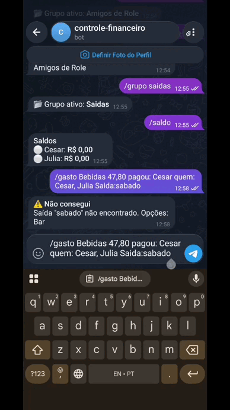
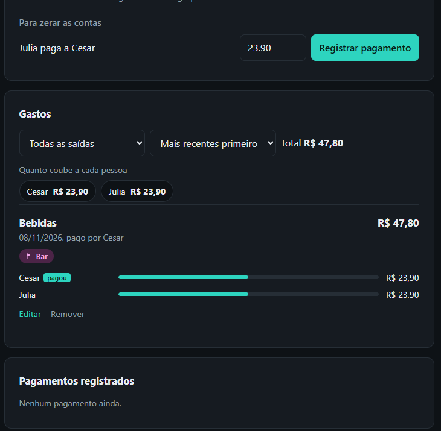

# Controle Financeiro

[](https://github.com/LittleCesta/controle-financeiro/.github/workflows/ci.yml)

Divisão de gastos entre amigos, com site e bot do Telegram. Registra quem pagou o quê, divide entre quem participou, calcula quanto cada pessoa deve e acompanha os pagamentos até zerar as contas.

Nasceu de um problema real: depois de cada rolê, uma pessoa paga o Uber, outra paga o bar, e a conta de quem deve a quem vira bagunça no grupo de mensagens. Aqui, o gasto é lançado em uma mensagem no Telegram e o site mostra os saldos na hora.

## Demonstração

<!-- Adicione um GIF curto (mandar um /gasto no Telegram e o site atualizando) e um print do site.
     Use nomes fictícios. Depois descomente as linhas abaixo.


-->

## Funcionalidades

**Site**

- Grupos com pessoas e **saídas** (um rolê agrupa vários gastos), com filtro por saída e ordenação por data.
- Gastos com divisão igual ou **valores diferentes por pessoa** (quem chegou tarde, quem não bebeu).
- Saldo de cada pessoa e **transferências mínimas** para zerar as contas, com registro do pagamento em um clique (inclusive parcial).
- Edição de gastos e remoção de gastos e pagamentos, com confirmação em modal.
- **Relatório em PDF** com saldos, gastos detalhados e pagamentos.

**Bot do Telegram**

- Lança gastos por mensagem, com data opcional (sem data, vale o dia do envio).
- Consulta de saldos e envio do relatório em PDF.
- Responde só ao dono, em conversa privada.

## Como o bot recebe um gasto

```
/gasto Uber 60 pagou:Cesar quem:Cesar,Ana,Bia saida:"Sábado Varanda" data:02/11
/gasto Bar 200 pagou:Ana quem:Cesar,Ana,Bia,Davi:20
```

| Campo    | O que faz                                                                     | Padrão                 |
| -------- | ----------------------------------------------------------------------------- | ---------------------- |
| `pagou:` | Quem pagou                                                                    | Nome definido em `/eu` |
| `quem:`  | Participantes. `Davi:20` fixa 20 para o Davi e divide o resto entre os outros | Todo o grupo           |
| `saida:` | Saída do gasto (precisa existir no site). Use aspas se tiver espaço           | Nenhuma                |
| `data:`  | `02/11`, `02/11/2026`, `hoje` ou `ontem`                                      | Dia do envio           |

Outros comandos: `/grupo Nome`, `/eu Nome`, `/saldo`, `/relatorio`, `/ajuda`. Nomes são comparados sem diferenciar acento ou maiúscula; se o nome for ambíguo, o bot responde com as opções em vez de gravar.

## Decisões técnicas

- **Dinheiro em centavos inteiros.** Em ponto flutuante, `0.1 + 0.2 !== 0.3`; com centavos, a soma das partes de um gasto sempre fecha o total. Na divisão por 3, quem sobra paga 1 centavo a mais.
- **O saldo é calculado, não salvo.** O banco guarda os fatos (gastos, partes de cada um, pagamentos) e o saldo sai de `pagou - parte + pagamentos feitos - pagamentos recebidos`. Corrigir um gasto atualiza tudo sem risco de inconsistência, e a soma dos saldos é sempre zero.
- **Quitação com menos transferências.** Cobrar gasto a gasto gera pagamentos cruzados; o saldo líquido reduz isso. Numa noite com um Uber de R$ 60 e um bar de R$ 200, são 3 transferências em vez de 5.
- **Remoção lógica (_soft delete_).** Gastos e pagamentos removidos ganham `deletedAt` e saem das contas, mas continuam no banco.
- **Um serviço único para criar gasto.** O site e o bot usam as mesmas funções (`createExpense`, `updateExpense`, `loadReportData`), então a validação e o relatório nunca divergem entre os dois.
- **Regras de dinheiro como funções puras** (`finance.ts`), fáceis de testar sem banco.

## Estrutura

```
src/
  server.ts     rotas HTTP e renderização
  bot.ts        bot do Telegram (processo separado do site)
  finance.ts    regras de dinheiro: conversão, divisão, saldos e quitação
  expenses.ts   criar e editar gasto (usado pelo site e pelo bot)
  report.ts     relatório em PDF
  db.ts         conexão e collections do MongoDB
views/          templates EJS
public/         CSS
```

Collections: `groups`, `people`, `outings`, `expenses`, `payments` e `bot_state`.

## Como executar

Pré-requisitos: Node.js 22+, npm e um MongoDB (local via Docker ou o [Atlas](https://www.mongodb.com/atlas)).

```bash
git clone https://github.com/LittleCesta/controle-financeiro.git
cd controle-financeiro
npm install
docker compose up -d      # MongoDB local (pule se usar o Atlas)
```

Crie um arquivo `.env` na raiz (ele está no `.gitignore`):

```
MONGO_URL=mongodb://localhost:27017
PORT=3000

# Bot (opcional)
TELEGRAM_TOKEN=token_gerado_no_BotFather
TELEGRAM_OWNER_ID=seu_id_numerico_do_telegram
```

Depois:

```bash
npm run dev     # site em http://localhost:3000
npm run bot     # bot do Telegram (em outro terminal)
```

Para o bot: crie o bot com o `@BotFather` (comando `/newbot`) para obter o token, e descubra o seu ID numérico com o `@userinfobot`.

| Script          | O que faz                     |
| --------------- | ----------------------------- |
| `npm run dev`   | Site com recarga automática   |
| `npm run bot`   | Bot do Telegram               |
| `npm test`      | Testes das regras de dinheiro |
| `npm run build` | Compila para `dist/`          |
| `npm start`     | Roda o site compilado         |

Observação: o `db.ts` define DNS públicos (1.1.1.1 e 8.8.8.8) para o Node, porque em algumas redes a consulta SRV do `mongodb+srv://` (Atlas) é recusada pelo DNS padrão.

## Testes e CI

`npm test` cobre conversão de valores, divisão (incluindo valor fixo por pessoa), saldos e quitação. Há um teste de propriedade com 300 cenários aleatórios (semente fixa) que verifica que os saldos somam zero, que as transferências zeram todo mundo e que são no máximo n-1. O GitHub Actions roda a checagem de tipos e os testes a cada push.

## Limitações e próximos passos

- **Sem login:** quem acessar o site vê todos os grupos. Use apenas localmente ou em rede privada.
- **Bot depende de processo ligado:** mensagens enviadas com o bot desligado são processadas ao ligar, se tiverem até 24 horas, e usam a data em que foram enviadas.
- **Sem proteção contra duplicidade no bot:** se o Telegram reenviar uma atualização, o gasto pode ser lançado duas vezes (raro com _polling_).
- **Próximos passos:** autenticação e convite por link, deploy com Docker, registro de pagamento pelo bot e lançamento por texto livre com confirmação.
